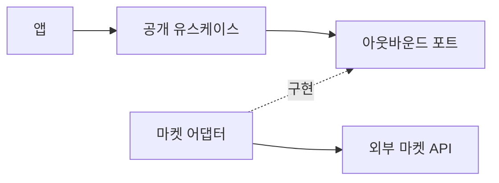

# SDK 헥사고날 설계

킷은 앱이 명시적으로 호출하는 SDK다. 앱은 실행 시점·수집 순서·저장·진행 상태·스캔 재시도 정책을 소유한다. 킷의 유스케이스는 호출된 기능을 완성하는 범위에서 동작하며 스케줄러·DB·작업 큐를 설치하지 않는다. marketplace의 네이버 토큰 갱신처럼 제공자 인증 계약에 필요한 처리는 마켓 어댑터가 담당한다.

## 호출 흐름과 의존 방향



실행 시 유스케이스가 포트에 연결된 어댑터를 호출한다. 코드 의존성은 안쪽을 향한다. 포트는 사용하는 유스케이스가 소유하고, 구체적인 어댑터가 그 포트를 구현한다. 생성 함수가 구현을 조립한 뒤 유스케이스를 공개한다.

앱은 공개 유스케이스를 직접 호출할 수 있다. HTTP·MCP 등의 전송 변환이 실제로 필요할 때 인바운드 어댑터를 추가한다. 단순 전달만 하는 인바운드 어댑터 계층을 일괄 생성하지 않는다.

## 역할과 의존 규칙

| 위치 | 역할 | 허용하는 내부 의존성 |
| --- | --- | --- |
| `domain/` | 업무 모델·불변식·오류 | domain |
| `application/` | 한 호출의 처리 흐름·유스케이스·아웃바운드 포트 | domain, application |
| `adapters/` | 외부 인증·통신·전문 해석·제공자별 계약 | domain, application, adapters |
| 공개 진입점 | 타입·유스케이스 노출 및 생성 함수에서 어댑터 조립 | 필요한 내부 구현 |

domain과 application은 외부 패키지·어댑터·공개 조립 진입점을 import하지 않는다. 런타임 통신과 비밀값 해석은 어댑터가 맡는다. 시간처럼 실제로 바뀌는 의존성은 작은 포트로 받는다. 포트는 업무 의미를 표현하고 HTTP 요청·JSON 전문 같은 제공자 표현을 유스케이스에 노출하지 않는다. 내부 helper마다 포트를 만들거나 공통 실행 엔진을 추가하지 않는다.

공개 포트와 내부 포트는 구분한다. 앱이 조립할 필요가 없는 마켓 포트를 패키지 exports로 공개하지 않는다. 공개 타입만 필요한 코드는 타입 전용 진입점에서 `import type`을 사용한다. 공개 생성 함수는 import·생성 시 외부 부수효과 없이 유스케이스를 조립한다. 부수효과·보안·호환성의 세부 계약은 [킷 조립 규약](kit-contract.md)이 소유한다.

## 현재 marketplace 적용

```text
src/
├── domain/              주문 모델·공통 오류
├── application/
│   ├── read-orders.ts   공개 readOrders 유스케이스 구현
│   ├── contracts.ts     공개 유스케이스의 입력·인터페이스
│   ├── ports.ts         OrderSource·Clock 아웃바운드 포트
│   └── clock.ts         주입된 시각의 검증과 안전한 오류 처리
├── adapters/
│   ├── coupang.ts       쿠팡 주문 조회·인증·변환
│   ├── naver.ts         네이버 변경·상세 조회·인증·변환
│   ├── protocol.ts      HTTP·응답·커서 처리
│   └── options.ts       전송·자격증명 조립에 사용하는 공통 설정 타입
├── coupang.ts           createCoupangClient 조립 진입점
├── naver.ts             createNaverClient 조립 진입점
├── types.ts             공개 타입 전용 진입점
└── index.ts             공통 오류·타입 공개
```

`createCoupangClient`와 `createNaverClient`는 내부 `OrderSource` 구현을 `createOrderReader`에 주입하고 `MarketplaceReader`를 반환한다. 앱은 기존처럼 `reader.readOrders(query)`를 호출한다. 별도 인바운드 어댑터는 없다.

유스케이스는 한 페이지를 읽고 공통 주문·항목 식별자의 중복을 검증한 뒤 관측 시각을 부여해 결과를 완성한다. `OrderSource`는 관측 시각을 제외한 정규화된 페이지를 반환한다. 시간 포트는 인증·관측 시각 모두에서 안전한 시간 검증을 거친다.

쿠팡의 상태별 KST 분단위 구간과 네이버의 변경 피드·상세 보충·계정별 커서는 어댑터에 둔다. 상세 보충까지 완료되어야 한 페이지가 성공한다. 마켓 차이를 지우기 위해 범용 `updatedSince`나 `execute(string, payload)` 계약을 만들지 않는다. 앱이 결과·커서를 저장하고 다음 호출을 결정한다.

이 구조는 SDK 내부의 현재 구현 기준이다. [초기 통합 설계안](../kits/marketplace/docs/design/marketplace-integration-design.md)의 Commerce·DB·동기화·작업 접수는 앱까지 포함한 구상이며 이번 SDK 구현에 포함되지 않는다.

## 변경과 검증

공개 유스케이스를 통해 인증·요청·응답 변환·오류·커서 동작을 검증한다. HTTP 응답을 fixture로 대체하고 실제 어댑터와 유스케이스를 함께 실행한다. 내부 helper 호출 순서를 테스트 계약으로 고정하지 않는다. 공통 업무 규칙이 늘어나면 domain/application에서 검증하고 마켓별 정책은 어댑터 계약으로 검증한다.

`check:architecture`는 정적 import·re-export·문자열 동적 import의 계층 의존성을 검사한다. 구조 변경은 이 검사와 기존 회귀 테스트, Node·Deno 실제 패키지 소비 검증을 통과해야 한다. 이 검사는 전역 API 사용이나 모든 실행 시 부수효과를 증명하지 않으므로 공개 호출 동작과 코드 리뷰를 함께 확인한다. 마켓 계정 검증과 앱 통합·운영 검증은 별도 범위로 기록한다.
