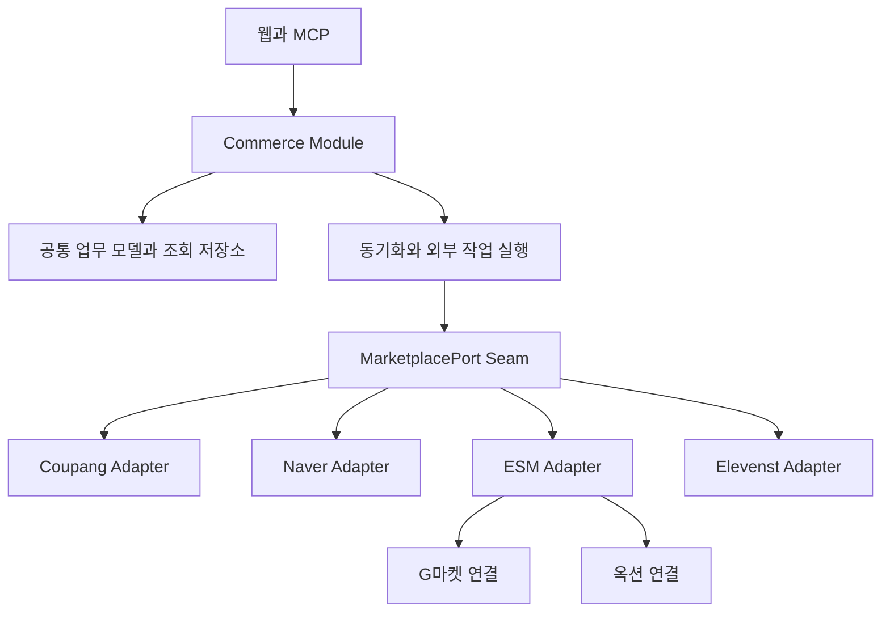
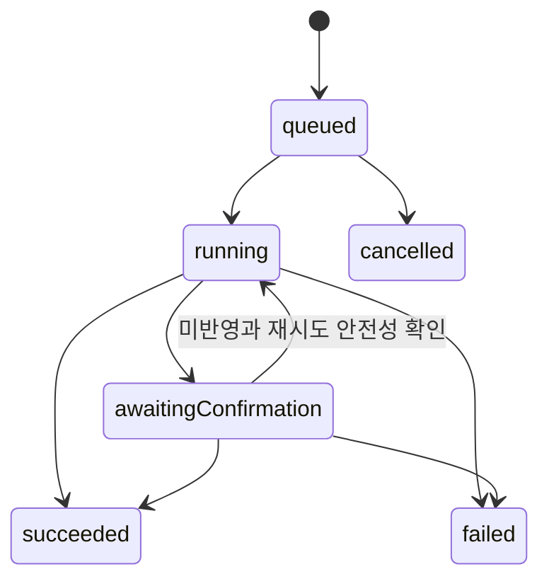

# 오픈마켓 통합 연동 설계안

> 적용 문맥: 이 문서는 호스트 앱까지 포함한 초기 통합 설계안이다. 현재 SDK 내부 구조는 [SDK 헥사고날 설계](../../../../docs/architecture.md), 킷과 호스트의 조립 계약은 [킷 조립 규약](../../../../docs/kit-contract.md)을 기준으로 한다. 아래 `Commerce` 조회·작업 영속 관리는 호스트 책임이며, 킷이 DB·큐·HTTP/MCP를 자동 설치한다는 뜻이 아니다. 전체 확장 범위는 [설계 이슈 #1](https://github.com/kimyongin/agent-workspace-kit/issues/1)에서 관리한다.

대상은 쿠팡, 네이버 스마트스토어, G마켓, 옥션, 11번가다. 판매자 상점의 상품·주문·출고·클레임·정산을 하나의 업무 인터페이스로 연결한다. 공통 업무의 의미를 통일하고 인증·전문·호출 제한·식별자 변환은 Adapter 안에 둔다. 지원 여부와 데이터의 신선도, 부분 실패, 외부 반영 결과 불명은 호출자에게 명시한다.

이 문서는 설계 제안이다. 현재 Workspace 제품에 커머스 기능 도입을 확정하거나 기존 자료·기록 모델을 변경하지 않는다. 실제 구현 전에는 제품 범위와 저장·권한 계약을 스펙으로 정한다. 근거는 [쿠팡·네이버 조사](../research/coupang-naver-commerce-apis.md)와 [G마켓·옥션·11번가 조사](../research/gmarket-auction-11st-open-apis.md)다.

## 1. Module과 Seam



외부 Interface는 판매자 연결 확인, 동기화 요청, 주문 조회, 업무 변경 접수, 처리 결과 조회다. 호출자가 토큰·XML·사이트 코드·페이지 번호·재시도 루프를 알 필요가 없어야 한다. Seam은 유스케이스가 외부 마켓과 대화하는 `MarketplacePort`에 둔다. HTTP/MCP는 동일 유스케이스를 호출한다.

ESM Adapter의 Implementation은 공유하지만 G마켓과 옥션의 연결·접근 권한·상품·주문 데이터는 구분한다. ESM 공통 상품 수정처럼 두 사이트에 영향을 줄 수 있는 작업은 영향 범위와 실행 잠금 대상을 함께 계산한다.

## 2. 공통화하는 범위

| 공통 업무 | 공통 계약 | Adapter에 남기는 차이 |
| --- | --- | --- |
| 판매자 연결 | 어떤 상점에 어떤 업무를 실행할 수 있는가 | HMAC, OAuth, JWT, API KEY, 승인·IP·키 갱신 |
| 상품 | 내부 SKU와 채널 판매상품·옵션의 연결 | 카테고리, 원상품·채널상품·마스터 상품, 필수 입력 |
| 주문 | 주문·주문항목·배송단위·클레임 분리 | 주문번호와 상품주문번호, 발주서·장바구니·묶음배송 |
| 동기화 | 정해진 범위의 수집 진행과 반영 결과 | 변경 피드, 상태별 기간 조회, 상세 재조회, 페이지 |
| 출고 | 특정 배송대상에 택배사·송장을 반영 | 선행 발주 확인, 분리배송, 송장 수정 허용 조건 |
| 재고 | 특정 판매단위의 판매가능 수량 설정 | 옵션·본품·물류창고 구분, 0 허용 여부 |
| 클레임 | 요청 조회와 명시적인 업무 행위 | 승인·거부·보류·수거확인 등의 상태 전이 |
| 정산 | 원장 항목과 원주문·배송의 연결 | 귀속일, 할인 분담, 수수료·배송비·환불 부호 |

상품 신규 등록은 공통 제목·설명만으로 완성할 수 없다. MVP는 기존 상품 매핑·조회와 가격·재고·판매상태 변경에 집중한다. 신규 등록은 추후 마켓별 상품 초안과 검증 Interface를 추가한다. 모든 API를 `execute(action, payload)`로 감싸는 범용 명령 엔진은 두지 않는다.

## 3. 연결과 기능 확인

`MarketConnection`은 소유 범위, 마켓, 판매자 상점, 자격증명 참조, 연결 상태를 가진다. 자격증명 값은 일반 조회 결과에 포함하지 않는다. 소유 범위의 구체적인 Workspace 연결 방식은 구현 스펙에서 확정한다.

기능 지원은 마켓명에 붙인 boolean 하나로 결정하지 않는다. 문서상 지원, 현재 판매자의 권한, 대상 상품·배송 유형에 적용 가능한지를 나눠 확인한다.

```ts
type Market = "coupang" | "naver" | "gmarket" | "auction" | "elevenst";
type Feature =
  | "catalog.read" | "orders.read" | "claims.read" | "settlements.read"
  | "orders.confirm" | "shipments.dispatch"
  | "inventory.set" | "offers.setPrice" | "offers.setSaleState"
  | "claims.acceptCancellation" | "claims.acceptReturn";

type FeatureAccess =
  | { state: "available"; constraints: Constraint[] }
  | { state: "unavailable"; reason: string }
  | { state: "needsVerification"; reason: string };

type Constraint =
  | { kind: "inventoryTarget"; allowed: ("base" | "option" | "warehouseSku")[] }
  | { kind: "quantityRange"; min: number; max: number }
  | { kind: "shippingMode"; allowed: string[] };
```

위 타입은 초기 계약의 예시다. Constraint는 실제 기능에 맞는 명명된 타입으로 늘리고 임의 코드 실행이나 자유 JSON 규칙을 받지 않는다. `available`도 특정 주문의 현재 상태에서 실행을 보장하지 않는다. 명령 실행 직전에 대상 상태와 권한을 다시 검사한다.

| 연결 | 이번 조사에서 설계에 반영할 제약 |
| --- | --- |
| 쿠팡 | 요청 서명·키 수명, 발주서·반품·교환의 별도 수집, 출고 전 배송지 재확인 |
| 네이버 | 토큰과 판매자 권한, 상품주문 변경 피드 이후 상세 조회, 내스토어와 솔루션 연동 구분 |
| G마켓·옥션 | ESM 승인, 사이트 구분, 공통 상품 마스터, 재고 수정 대상 제한, API별 호출 제한 |
| 11번가 | Seller API와 상품검색 API 구분, XML 처리, 호출 시 키 수명 연장, 정산 상세 계약 미확인 |

11번가 정산은 초기값을 `needsVerification`으로 둔다. 모르는 기능을 성공하는 빈 응답이나 `unavailable`로 대체하지 않는다. 권한 거절과 실제 미지원도 별도 사유로 남긴다.

## 4. 업무 모델

| 모델 | 의미와 보존할 정보 |
| --- | --- |
| SKU | 내부에서 관리하는 판매·재고 단위. 채널 상품명과 독립적인 식별자 |
| ChannelListing | 채널 상품. 마켓 판매자와 상품·옵션 식별자, SKU 매핑, 판매상태 |
| Order | 채널 주문의 묶음. 원본 주문번호와 주문 시각 |
| OrderLine | 구매한 상품·옵션·수량. 네이버 상품주문번호 등 원본 행 식별자 |
| Fulfillment | 출고할 묶음과 연결된 주문항목별 수량. 송장 여러 개와 분리출고 가능성 |
| Claim | 취소·반품·교환 요청. 대상 항목·수량·금액·원본 상태·사유 |
| SettlementEntry | 정산 데이터셋의 원장 항목. 원본 행 키·귀속일·금액·연결 주문·배송 |

외부 참조는 `{ connectionId, resourceKind, externalId }`로 표현한다. ID는 문자열이며 JSON 숫자 파싱 단계부터 정밀도를 보존한다. 원본 `orderId`, `shipmentBoxId`, `productOrderId`, `goodsNo`, `ContrNo`를 하나의 외부 번호로 합치지 않는다. 실제 마켓이 제공하는 필드만 저장하고 내부 묶음이 필요한 경우 내부 ID를 별도로 발급한다.

금액은 `{ currency, decimalAmount }`로 표현하고 `decimalAmount`는 부호 있는 10진 문자열이다. 부동소수점으로 금액을 계산하지 않는다. 정산 항목의 구매금액·수수료·할인 분담·환불을 구분하며 요약금액과 세부금액을 함께 합산하지 않는다. 날짜의 의미(결제일·구매확정일·송금일)와 원본 시간대를 보존한다. 원장 ID가 없으면 해당 데이터셋에서 검증한 복합키를 사용하고 모든 플랫폼에 같은 키 공식을 강요하지 않는다.

주문은 결제·출고·클레임 상태를 분리한다. 예를 들어 일부 반품이 발생해도 주문 전체를 `returned`로 바꾸지 않는다. 공통 상태는 목록·검색에 사용하고 원본 상태·사유·관측 시각을 보존한다. 새 원본 상태는 `unknown`으로 표시하며 쓰기를 보수적으로 차단한다. 미확인 값을 기존 상태에 추측 매핑하지 않는다.

전체 원문 payload를 영구 보관하는 것을 기본값으로 삼지 않는다. 진단에 필요한 최소 필드와 제공자 추적 ID를 보존하고, 개인정보가 포함된 원문 보관은 허용 범위·접근·수명이 확정된 경우에만 추가한다.

## 5. 호출자가 사용하는 Interface

다음은 계약 설명용 TypeScript다. `OrderQuery`, `Command`, `SyncScope` 등 도메인 타입은 아래 의미와 제한을 따른다.

```ts
interface Commerce {
  describeConnection(connectionId: string): Promise<ConnectionDescription>;
  synchronize(request: SyncRequest): Promise<SyncRun>;
  queryOrders(query: OrderQuery): Promise<OrderPage>;
  getOrder(orderRef: ResourceRef): Promise<OrderDetail>;
  submit(request: CommandRequest): Promise<Operation>;
  getOperation(operationId: string): Promise<Operation>;
}

type SyncScope = "catalog" | "orders" | "claims" | "settlements";
type Command =
  | { kind: "confirmOrder"; target: ResourceRef }
  | { kind: "dispatchShipment"; target: ResourceRef;
      carrier: string; trackingNumber: string; lines: LineQuantity[] }
  | { kind: "setAvailableStock"; target: ResourceRef; quantity: number }
  | { kind: "setPrice"; target: ResourceRef; price: Money }
  | { kind: "setSaleState"; target: ResourceRef; state: "selling" | "paused" }
  | { kind: "acceptCancellation"; target: ResourceRef }
  | { kind: "acceptReturn"; target: ResourceRef };

type CommandRequest = {
  requestKey: string;
  expectedVersion: number;
  command: Command;
};
```

인증된 Actor와 소유 범위는 서버의 실행 문맥에서 받는다. 요청자가 입력한 owner 값을 권한 근거로 사용하지 않는다.

`queryOrders`와 `getOrder`는 로컬 조회 모델을 읽는다. 결과에는 `observedAt`, `lastSuccessfulSyncAt`, `coverage`, 현재 동기화 오류를 포함한다. 오래된 값이나 접근 불가를 ‘주문 없음’으로 표시하지 않는다. 외부 마켓 실시간 재조회가 필요하면 동기화를 명시적으로 요청한다.

`synchronize`는 비동기 수집을 접수하고 실행 ID를 반환한다. 최초 수집·진행 수집·재대사는 별도 모드이며 요청 범위와 커버리지를 기록한다. 오래된 전체 주문 이력을 제공한다고 보장하지 않는다.

`submit`은 한 업무 의도를 영속 접수한다. 접수 성공은 외부 반영 성공이 아니다. `expectedVersion`은 로컬 대상이 사용자 확인 이후 바뀌었는지 검사하는 값이며 마켓의 compare-and-swap 보장이 아니다. 외부 상태는 실행 직전에 다시 읽고 가능한 마켓의 조건부 요청을 사용한다. 외부 판매자센터에서 동시에 수정하는 경쟁까지 완전히 제거할 수는 없다.

호출량이 작은 초기 제품에서도 공개 계약에 채널의 IP·JWT를 전달하지 않는다. HTTP/MCP는 각각의 전송 형식만 변환하고 같은 권한 검사·작업 접수·결과를 제공한다.

## 6. Adapter의 Interface

```ts
interface MarketplacePort {
  describe(): Promise<ConnectionDescription>;
  pull(request: PullRequest): Promise<PullPage>;
  refresh(refs: ResourceRef[]): Promise<RefreshResult[]>;
  apply(command: PreparedCommand): Promise<ProviderReceipt>;
  inspect(attempt: ProviderAttempt): Promise<InspectionResult>;
}
```

각 Adapter는 서버 조립 시 특정 연결에 묶는다. `refresh`·`apply` 대상이 다른 연결이면 전송 전에 거부한다. 자격증명 저장소, HTTP 전송, 시간, 호출 제한기는 Implementation에 주입하며 클라이언트에서 생성하지 않는다.

`pull`은 제공자의 조회 결과를 완성된 공통 snapshot으로 변환한다. 네이버 변경 식별자 이후 상세 조회 같은 보충 작업은 Adapter가 처리한다. `PullPage`는 `upserts`, `explicitRemovals`, `nextCursor`, `coverage`, `scanComplete`를 가진다. 단순 목록에 없는 항목은 삭제·취소로 해석하지 않는다. 상세 조회 실패도 삭제가 아니며 실패를 남겨 재시도한다.

`apply`는 명시적인 지원 명령만 처리한다. 수량 0을 지원하지 않는 재고 API에서 임의로 판매중지 명령으로 바꾸지 않는다. 상품·출고 유형에 맞는 문서화된 방법이 검증된 경우에만 처리하고, 아니면 제약 오류를 반환한다. 택배사 매핑 실패도 임의의 코드로 대체하지 않는다.

`inspect`는 시간초과된 요청의 반영 여부를 확인한다. 결과는 `applied`, `notApplied`, `pending`, `inconclusive`다. 제공자의 결과 조회 기능이 없으면 관련 리소스를 재조회하지만, 현재 값이 같다는 사실만으로 해당 명령이 실행됐다고 항상 증명할 수는 없다. `notApplied`는 안전하게 미반영을 입증할 수 있을 때만 반환한다.

## 7. 동기화의 일관성

수집은 연결·업무·조회 분할 단위로 직렬화한다. 커서는 Adapter 버전, 연결, 업무, 조회조건 fingerprint에 묶인 불투명 값이다. 다른 연결에서 재사용하거나 사용자가 외부 API 커서를 직접 편집할 수 없게 한다.

1. 수집 범위와 기준 종료 시각을 고정하고 `pull`로 한 페이지를 얻는다.
2. 한 로컬 트랜잭션에서 snapshot 반영과 다음 커서·진행 상태 저장을 함께 확정한다.
3. 다음 페이지를 수집한다. 상세 보충 조회가 실패한 페이지의 진행 위치는 건너뛰지 않는다.
4. 마지막 페이지까지 반영했을 때 해당 범위의 `coverage`를 확정한다.
5. 이후 수집은 겹치는 기간을 포함해 중복 제거하고 정기 재대사로 누락을 찾는다.

네이버 변경 피드는 변경 시각과 후속 커서를 추적한다. 쿠팡·ESM 같은 기간·상태별 조회는 공급자의 시간 조건에 맞는 스캔과 재대사로 수집한다. 세 방식을 모두 `updatedSince` 하나로 위장하지 않는다. 주문과 클레임은 각각 수집하며 화면의 최신성도 각각 표시한다.

동일 대상에 오래된 snapshot이 덮어쓰이지 않도록 공급자 revision이 있으면 비교한다. 없으면 대상별 refresh·동기화를 직렬화하고 로컬 쓰기 뒤 오래된 진행 중 조회 결과를 폐기한다. 관측 시각은 공급자 변경 시각이 아니며, 이 방식도 외부의 최종 일관성 지연을 완전히 해소하지는 않는다.

호출 제한은 실제 제한 집계 단위에 맞춘다. 연결별 큐 외에도 ESM 마스터·네이버 애플리케이션 등 여러 판매자에게 공유되는 bucket을 지원한다. 수치는 버전과 출처를 가진 Adapter 설정 또는 응답 헤더에서 얻고 전체 마켓 공통 상수로 두지 않는다.

## 8. 외부 변경과 결과 불명



`awaitingConfirmation`은 마켓 반영 여부를 아직 알 수 없다는 뜻이다. 시간이 지났다는 이유로 실패로 바꾸지 않는다. 조회로 확정할 수 없으면 이 상태와 필요한 수동 확인을 유지한다. 전송 후 취소 요청은 외부 작업을 되돌렸다는 뜻이 아니며, `cancelled`는 미전송 작업에만 허용한다.

로컬 접수는 소유 범위·requestKey·입력 fingerprint와 작업을 한 트랜잭션으로 저장한다. 같은 키·같은 입력은 같은 작업을 반환하고 다른 입력이면 거절한다. 현재 권한은 재요청에도 검사한다. 키 보관 수명은 프로젝트 요청 계약과 실제 구현 스펙에 맞추며, 원래 외부 작업의 재시도는 새 requestKey를 발급하지 않고 동일 operation ID로 수행한다.

외부 호출에는 로컬 DB 트랜잭션이 적용되지 않는다. 작업 접수와 필수 큐 등록만 원자적으로 묶는다. 실행 시도·제공자 추적 ID·응답 요약을 남겨 중단 후 복구하며 제공자가 지원하는 경우에만 제공자 멱등 키를 사용한다. worker lease 만료·재시작만으로 동일 명령을 다시 전송하지 않는다. 전송 직전 증거를 저장한 시도부터 결과를 확인하고, 원격 처리 종료가 불명인 동안 같은 대상의 후속 쓰기도 보류한다. 정확히 한 번의 외부 실행을 보장한다고 주장하지 않는다.

공개 MVP 명령은 가능한 한 한 배송대상·한 SKU·한 클레임을 대상으로 한다. 내부적으로 여러 제공자 요청이 필요하면 각 하위 결과를 저장한다. 일부만 성공한 작업은 `outcome: partial`과 성공·실패·결과불명 대상을 제공한다. 결과불명 항목이 남으면 상태는 `awaitingConfirmation`, 모두 확정됐으나 일부가 실패했으면 `failed`, 전부 반영됐을 때만 `succeeded`다. 이후에는 실패한 부분만 새로 평가한다.

ESM 상품 마스터를 공유하는 두 채널, 같은 송장을 공유하는 출고대상처럼 외부 실제 수정 단위가 겹치는 경우 동일 잠금을 사용한다. 단순히 connectionId별 직렬화만 적용하면 G마켓·옥션 작업이 같은 마스터를 동시에 덮어쓸 수 있다. 잠금은 외부 원자성을 만들지 않으며 작업의 실제 영향 범위도 응답과 사용자 확인에 포함한다.

## 9. 재고의 정본

MVP의 `setAvailableStock`은 지정된 한 채널 판매단위에 절대 수량을 설정한다. 모든 채널이 동일한 창고재고를 공유한다고 가정하지 않는다. 주문으로 차감한 판매가능 수량과 창고 실재고를 구분한다.

여러 채널 재고 자동화를 추가할 때는 내부 재고 정본, 예약 수량, 안전재고, 취소 복원 규칙을 먼저 확정한다. SKU별 현재 원하는 수량과 revision을 저장하고 오래된 미전송 작업은 최신 값으로 대체한다. 이미 전송된 이전 요청의 처리가 불명하면 후속 덮어쓰기를 보류한다. 채널별 성공·지연·실패를 표시하고 초과판매 위험을 관리한다. 여러 마켓의 동시 재고 변경을 하나의 트랜잭션처럼 보장하지 않는다.

## 10. 오류와 보안

| 오류 의미 | 처리 |
| --- | --- |
| 인증 만료·회수 | 해당 Adapter의 검증된 갱신 경로 실행, 불가능하면 연결 재인증 요청 |
| 권한 없음·미지원·미검증 | 구분해 반환하고 자동 재시도하지 않음 |
| 입력·상태 충돌 | 현재 값과 허용 행위 재조회. 임의의 다른 명령으로 바꾸지 않음 |
| 호출 제한 | 실제 bucket과 대기 시각을 기록해 지연. 업무 실패로 단정하지 않음 |
| 전송 전 일시 오류 | 제한된 재시도와 backoff |
| 전송 후 결과 불명 | awaitingConfirmation. 재조회 후 처리 |

주문 개인정보·자격증명·동기화 커서·작업 결과는 같은 소유 범위로 격리한다. 서버가 연결과 대상의 소속을 확인하고 일반 사용자 입력으로 마켓 호출 호스트를 받지 않는다. 키·전체 주문 전문을 로그·MCP 설명·AI 프롬프트에 넣지 않는다. 보관 기간과 외부 전송 조건이 확정되지 않은 원문은 수집하지 않는다.

## 11. 구현 순서와 검증

| 순서 | 결과물과 검증 기준 |
| --- | --- |
| 1 | 계정별 기능·권한·실제 판매자 계약 확보. 11번가 정산 등 미확인 기능은 쓰기 구현에 포함하지 않음 |
| 2 | 쿠팡·네이버 주문/클레임 읽기로 공통 모델과 pull 계약 검증. 두 Adapter의 차이가 실제 Seam을 지지하는지 확인 |
| 3 | ESM Adapter와 G마켓·옥션 두 연결, 11번가 Adapter 추가. 외부 식별자·권한·페이지 누락 검증 |
| 4 | 단일 배송대상 송장과 SKU 재고 명령. 시간초과·중복·부분 성공·외부 동시 수정·재시작 복구 검증 |
| 5 | 정산 대사와 필요한 상품·클레임 쓰기만 확장 |

공통 Interface를 통과하는 Adapter 계약 테스트는 인증·권한 차단, 마지막 페이지·상세 조회 실패 후 재개, 같은 시각의 여러 변경, 알려지지 않은 상태, 정밀도 큰 ID, 환불 부호, 원본 삭제와 조회 실패의 구분을 확인한다. 외부 명령 테스트는 응답 유실·worker 중단·공유 ESM 마스터 경쟁·재고 작업 역전·항목별 부분 실패를 다룬다. mock 성공과 실제 계정의 권한·필드·부수효과 검증은 별개 증거로 남긴다.

## 12. 이 설계의 적용 범위

정규화된 읽기 모델과 업무 명령을 중심으로 시작한다. 별도 메시지 브로커, 이벤트 소싱, 플러그인 로더, 범용 스키마 엔진을 선행 도입할 필요는 없다. 저장·큐는 실제 제품 환경에서 이미 검증된 수단을 사용한다. 새로운 커머스 도메인 테이블과 Workspace 자료·기록 사이의 연결은 제품 합의 후 설계하며, 기존 범용 본문 모델에 주문 원장을 임의로 끼워 넣지 않는다.

## 13. 같은 요청이 마켓별로 처리되는 예

`setAvailableStock(target, 0)` 요청을 받으면 먼저 SKU 매핑·상품유형과 현재 권한을 확인한다. 해당 채널의 검증된 품절 반영 방법이 있으면 실행하고, ESM 본품 재고 수정 전용 API처럼 허용 범위에 0이 없는 계약만 확보되어 있으면 제약 오류를 반환한다. 같은 수량 요청이라는 이유로 몰래 판매중지로 전환하지 않는다.

`dispatchShipment(target, carrier, trackingNumber)` 요청은 출고대상의 최신 주문·클레임·배송지를 확인한 뒤 채널 택배사 코드로 변환한다. 쿠팡 Adapter는 요구되는 발주서 재확인을 수행한다. 전송 후 응답이 유실되면 작업 ID를 유지하며 송장·출고 결과를 재조회한다. 이후 실행 요청이 도착해도 기존 작업을 확인하지 않은 채 같은 송장을 다시 전송하지 않는다.

G마켓과 옥션에 연결된 하나의 ESM 마스터 상품 가격을 변경할 때는 Adapter가 실제 수정 범위를 계산한다. 한 사이트만 수정할 수 있는 명세를 사용하거나, 두 사이트가 함께 바뀌는 경우 두 대상이 포함된 명시적인 의도로 접수한다. 공통 Implementation을 사용한다는 이유로 다른 채널을 숨겨서 변경하지 않는다.
